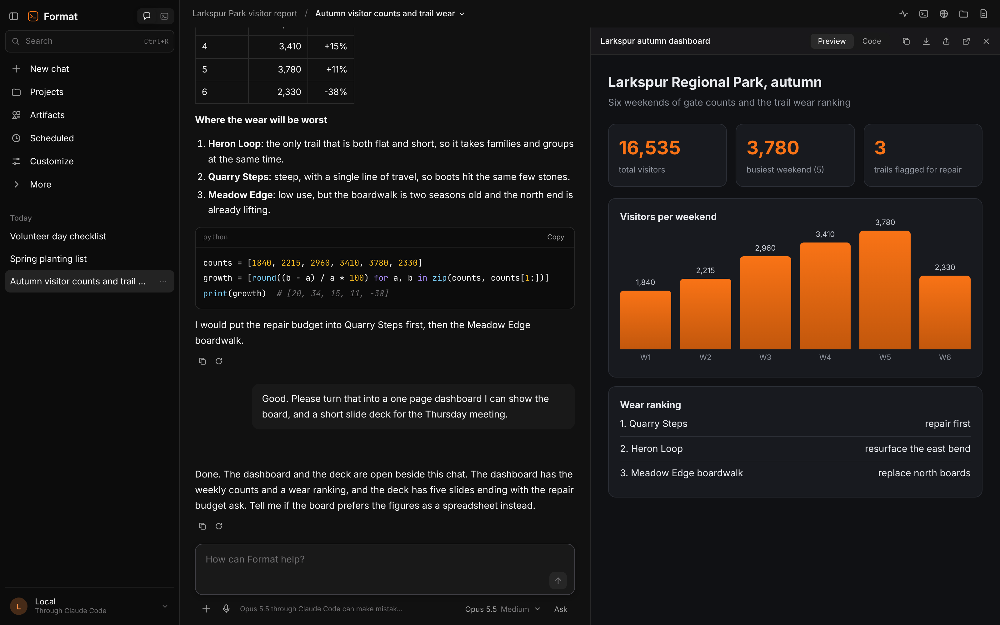
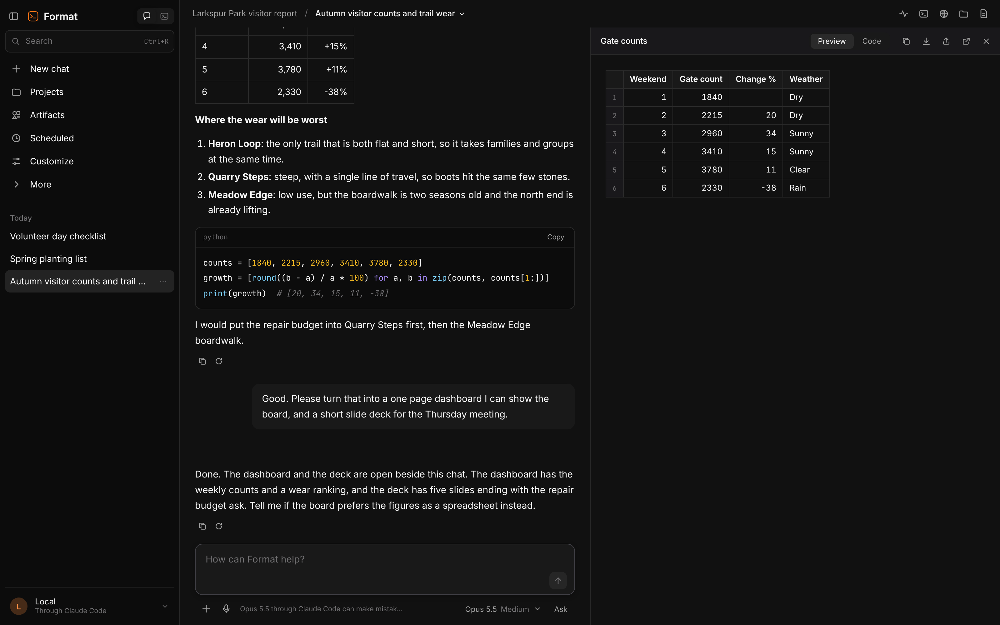

<p align="center">
  
</p>

<h1 align="center">FormAT</h1>

<p align="center">
  <b>Chat and agent workspace; Claude chats, artifacts, projects and real terminals on your own key.</b><br>
  Conversations, pages and documents beside the chat, shells in a dock,<br>
  in one window with no account. Runs on your own computer.
</p>

<p align="center">
  
  
  
  
  
  
</p>

<p align="center">
  <a href="https://format.formai.studio/"><b>Download FormAT on formai.studio</b></a> · <a href="https://github.com/nodemode-dev/formcompiler/releases?q=format-v&expanded=true">Latest release</a> · <a href="#run-it-from-source">Run it from source</a> · <a href="#the-form-family">All Form apps</a>
</p>

<p align="center">
  
  <br>
  <sub>A chat in a project, with the dashboard Claude published open beside it.</sub>
</p>

<p align="center">
  <a href="#features">Features</a> · <a href="#everything-in-the-box">In the box</a> · <a href="#built-for-agents">Agents</a> · <a href="#under-the-hood">Under the hood</a> · <a href="#download">Download</a> · <a href="#run-it-from-source">Run from source</a> · <a href="#the-form-family">Form family</a>
</p>

<table>
  <tr>
    <td width="25%" valign="top"><h3>Your key, your data</h3>Chats, files and memory live in a local data folder; the API key stays on your computer.</td>
    <td width="25%" valign="top"><h3>Artifacts beside the chat</h3>Claude publishes pages, documents, sheets and slides that open next to the conversation, with versions.</td>
    <td width="25%" valign="top"><h3>Real terminals</h3>A dock of real shells sits under the chat, and Claude's own commands run live in a read-only tab.</td>
    <td width="25%" valign="top"><h3>Agent-ready</h3>The same engine commands run from the window, the CLI and an MCP server for coding agents.</td>
  </tr>
</table>

## Features

<table>
  <tr>
    <td width="50%" valign="top">
      
      <br><sub>A slide deck written as Markdown, paged beside the chat.</sub>
      <h3>Slides and documents</h3>
      Decks, documents and spreadsheets export to Word, Excel, PowerPoint and PDF.
    </td>
    <td width="50%" valign="top">
      
      <br><sub>A spreadsheet artifact with its own tab in the panel.</sub>
      <h3>Spreadsheets</h3>
      Claude writes a sheet from CSV and you read it beside the chat, with versions.
    </td>
  </tr>
  <tr>
    <td width="50%" valign="top">
      
      <br><sub>A project with shared instructions and its chats.</sub>
      <h3>Projects</h3>
      Instructions and knowledge files apply to every chat in a project.
    </td>
    <td width="50%" valign="top">
      <h3>Pages and apps</h3>
      HTML pages and small tools run in a sandbox with Preview and Code views, download and share links.
    </td>
  </tr>
</table>

## Everything in the box

<table>
  <tr>
    <td width="33%" valign="top"><h4>Chat</h4>Edit any message and page between versions · Compaction of long chats · Search chats · Code colouring and math · Dictation · Command palette</td>
    <td width="33%" valign="top"><h4>Workspace</h4>Projects · Artifacts page · Files pane · Memory · Skills · Plugins and marketplaces · Connectors · Scheduled tasks · Built-in browser · Other devices</td>
    <td width="33%" valign="top"><h4>Providers and formats</h4>Anthropic API · Claude Code route · OpenAI and Cursor adapters · Exports: <code>.docx</code> · <code>.xlsx</code> · <code>.pptx</code> · PDF</td>
  </tr>
</table>

## Built for agents

112 engine commands live in one registry; the window, the CLI and the MCP server call the same ones.

```sh
./format cli list                              # every engine command
./format cli chat.send text="..."              # chat from a terminal or an agent
./format cli chat.wait conversationId=...      # wait for the reply
./format mcp                                   # MCP server on stdio for Claude Code, Codex and Cursor
```

`.mcp.json`, `.codex/config.toml` and `.cursor/mcp.json` are already wired in this repo. See [`AGENTS.md`](AGENTS.md).

## Under the hood

- **Engine:** Python 3.12 and FastAPI on `127.0.0.1:8490`, with a store, an event stream and one module per command group.
- **Window:** vanilla TypeScript and Vite, with inline SVG icons and no UI framework.
- **Desktop:** Tauri 2 around the engine frozen with PyInstaller, so the app needs no Python or Node.
- **Tested:** 63 Python tests (commands, approvals, chat tree, artifacts, MCP, migrations, release profiles).

## Download

**Get the app:** download FormAT from [formai.studio](https://format.formai.studio/). That is the easiest way to install it. The latest builds are on the [FormCompiler releases](https://github.com/nodemode-dev/formcompiler/releases?q=format-v&expanded=true) page.

**Keep it updated:** [FormPortal](https://github.com/nodemode-dev/formportal) installs, updates and rolls back every Form app.

| Platform | Builds |
|---|---|
| macOS (Apple silicon, Intel) | desktop app |
| Linux x64 | desktop app |
| Windows x64 | desktop app |

All FormAT builds are compiled and released from [`nodemode-dev/formcompiler`](https://github.com/nodemode-dev/formcompiler/releases), not from this repo. This repo holds the source.

## Run it from source

Prefer it in your browser, or want to contribute? Run the web UI straight from this repo.

**Requires:** Node 20.19 or newer (22 recommended), Python 3.12 or newer, git. ffmpeg on the PATH for video and audio.

```sh
git clone git@github.com:nodemode-dev/format.git
cd format
./format_oc_install   # engine venv, frontend packages, backend/.env from the example
./format              # engine on 127.0.0.1:8490, web UI at http://localhost:5490
```

`./format desktop dev` opens the desktop window instead, and `./build_app` builds the desktop app on macOS or Linux.

On Windows run `.\format.bat install` then `.\format.bat`, never a bare `format`: that name is Windows' disk formatter.

| Service | URL | Notes |
|---|---|---|
| Engine | http://127.0.0.1:8490 | FastAPI; `FORMAT_PORT` overrides |
| Window (dev) | http://localhost:5490 | Vite, proxies `/api` and `/api/events` |
| MCP for agents | http://127.0.0.1:8490/mcp | Streamable HTTP; `./format mcp` serves stdio |

Add `ANTHROPIC_API_KEY` in `backend/.env` or in Settings. No key? If Claude Code is installed and signed in, FormAT answers through it on your Claude plan.

> [!IMPORTANT]
> **Status:** active, pre-1.0. The native renderer is optional and off by default, and the window's terminal stays the browser one. See [`CHANGELOG.md`](CHANGELOG.md).

**Contributing:** branch from `main`, keep changes to source here, and leave packaging and releases to FormCompiler. See [`BRANCHING.md`](BRANCHING.md) and [`AGENTS.md`](AGENTS.md).

## Repository

| Path | What it is |
|---|---|
| `backend/app/` | the engine: commands, events, store, routers, harness, providers |
| `frontend/src/` | the window: sidebar, composer, chat, panel, terminal, palette |
| `setup/` | install, boot, build, serve, doctor and the CLI |
| `src-tauri/` | the Tauri 2 desktop shell |

Docs: [`docs/`](docs/README.md) · Wiki: [`.docs/wiki`](.docs/wiki/Home.md) · Agents: [`CLAUDE.md`](CLAUDE.md), [`AGENTS.md`](AGENTS.md) · Contributing: [`BRANCHING.md`](BRANCHING.md)

## The Form family

FormAT is one of the **Form apps**: native creative tools that install, update and roll back through FormPortal and can all be driven by agents.

| | App | What it's for | Download | Code |
|:-:|---|---|---|---|
|  | **form.md** | Documents, databases and realtime editing together | [formai.studio](https://formmd.formai.studio/) | [GitHub](https://github.com/nodemode-dev/form.md) |
|  | **FormAT** | Chat and agent workspace on your key | [formai.studio](https://format.formai.studio/) | [GitHub](https://github.com/nodemode-dev/format) |
|  | **FormCAD** | Drafting, parametric parts and NURBS surfaces | | [GitHub](https://github.com/nodemode-dev/formCAD) |
|  | **FormCel** | Spreadsheets agents can read and edit | [formai.studio](https://formcel.formai.studio/) | [GitHub](https://github.com/nodemode-dev/formcel) |
|  | **FormCraft** | Generate images, video, audio, 3D and worlds | | [GitHub](https://github.com/nodemode-dev/formcraft) |
|  | **FormCut** | Multi-track video editing with no upload | [formai.studio](https://formcut.formai.studio/) | [GitHub](https://github.com/nodemode-dev/formcut) |
|  | **FormDAM** | Photo library and asset manager | [formai.studio](https://formdam.formai.studio/) | [GitHub](https://github.com/nodemode-dev/formDAM) |
|  | **FormDeck** | Presentations and pitch decks | [formai.studio](https://formdeck.formai.studio/) | [GitHub](https://github.com/nodemode-dev/formdeck) |
|  | **FormDesign** | Page layout for print and the web | [formai.studio](https://formdesign.formai.studio/) | [GitHub](https://github.com/nodemode-dev/formdesign) |
|  | **FormEncoder** | Media encoding queue with presets | [formai.studio](https://formencoder.formai.studio/) | [GitHub](https://github.com/nodemode-dev/formencoder) |
|  | **FormFabric** | Sewing patterns draped with cloth simulation | | [GitHub](https://github.com/nodemode-dev/formfabric) |
|  | **FormLit** | Photo library and raw development | [formai.studio](https://formlit.formai.studio/) | [GitHub](https://github.com/nodemode-dev/formlit) |
|  | **FormMorpheus** | Frame-by-frame and performed animation | | [GitHub](https://github.com/nodemode-dev/formmorpheus) |
|  | **FormNET** | See what your computer sends online | | [GitHub](https://github.com/nodemode-dev/formNET) |
|  | **FormPath** | Vector illustration with artboards and type | [formai.studio](https://formpath.formai.studio/) | [GitHub](https://github.com/nodemode-dev/formpath) |
|  | **FormPDF** | Edit, redact, sign and fill PDFs | [formai.studio](https://formpdf.formai.studio/) | [GitHub](https://github.com/nodemode-dev/formpdf) |
|  | **FormPromo** | Promo films from your own media | [formai.studio](https://formpromo.formai.studio/) | [GitHub](https://github.com/nodemode-dev/formpromo) |
|  | **FormRef** | Reference boards for creative work | [formai.studio](https://formref.formai.studio/) | [GitHub](https://github.com/nodemode-dev/formref) |
|  | **FormRig** | Rig, skin and retarget any mesh | | [GitHub](https://github.com/nodemode-dev/formrig) |
|  | **FormSculpt** | 3D sculpting, remeshing and painting | [formai.studio](https://formsculpt.formai.studio/) | [GitHub](https://github.com/nodemode-dev/formsculpt) |
|  | **FormSurface** | Texture painting with PBR export | [formai.studio](https://formsurface.formai.studio/) | [GitHub](https://github.com/nodemode-dev/formsurface) |
|  | **FormTools** | Viewers, batch tools and file utilities | | [GitHub](https://github.com/nodemode-dev/formtools) |
|  | **FormTxt** | Word processing with .docx round trips | [formai.studio](https://formtxt.formai.studio/) | [GitHub](https://github.com/nodemode-dev/formtxt) |
|  | **FormVFX** | Motion graphics and VFX compositing | [formai.studio](https://formvfx.formai.studio/) | [GitHub](https://github.com/nodemode-dev/formvfx) |
|  | **FormVis** | Layered image editing with local AI | [formai.studio](https://formvis.formai.studio/) | [GitHub](https://github.com/nodemode-dev/formvis) |
|  | **FormWav** | Multitrack audio editing and mixing | [formai.studio](https://formwav.formai.studio/) | [GitHub](https://github.com/nodemode-dev/formwav) |
|  | **FormWeb** | Visual website building with a CMS | [formai.studio](https://formweb.formai.studio/) | [GitHub](https://github.com/nodemode-dev/formweb) |
|  | **FormPortal** | Install, update and roll back Form apps | [formai.studio](https://formportal.formai.studio/) | [GitHub](https://github.com/nodemode-dev/formportal) |
|  | **FormTray** | One dock icon for every app | [formai.studio](https://formtray.formai.studio/) | [GitHub](https://github.com/nodemode-dev/formtray) |
|  | **FormMCP** | One MCP connection to the family | [formai.studio](https://formmcp.formai.studio/) | [GitHub](https://github.com/nodemode-dev/formMCP) |
|  | **FormSkills** | Every app's agent skills in one place | [formai.studio](https://formskill.formai.studio/) | [GitHub](https://github.com/nodemode-dev/formskills) |
|  | **FormBench** | Parity, testing and rankings for the family | [formai.studio](https://formranker.formai.studio/) | [GitHub](https://github.com/nodemode-dev/formbench) |
|  | **FormSlot** | Codebase memory for coding agents | | [GitHub](https://github.com/nodemode-dev/formslot) |
|  | **SubForm** | Workbench for parallel Claude Code agents | | [GitHub](https://github.com/nodemode-dev/subform) |
|  | **FormCompiler** | Builds, signs and releases every app | [formai.studio](https://formcompiler.formai.studio/) | [GitHub](https://github.com/nodemode-dev/formcompiler) |
|  | **FormPipe** | Release pipeline and update feeds | | [GitHub](https://github.com/nodemode-dev/formpipe) |

---

## Maintainers

| Maintainer | Role |
|---|---|
| [@nodemode-ai](https://github.com/nodemode-ai) | Owner |
| [@gbarnai](https://github.com/gbarnai) | Co-owner |

Code owners are set in [`.github/CODEOWNERS`](.github/CODEOWNERS).

## License

FormAT is licensed under the Apache License 2.0 ([`LICENSE`](LICENSE), SPDX `Apache-2.0`). Copyright 2026 NodeAgentc, Inc. Third-party notices: [`NOTICE.md`](NOTICE.md).

<sub>FormAT is an independent project and is not affiliated with or endorsed by Anthropic, OpenAI or Cursor.</sub>
