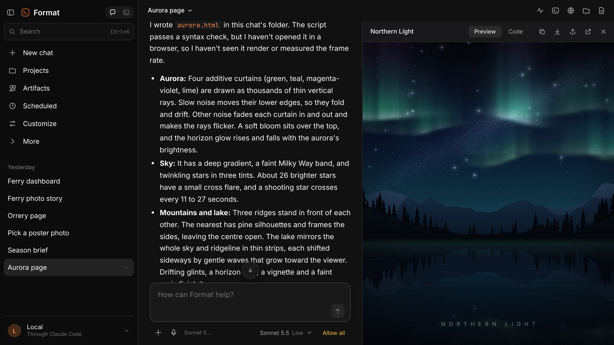
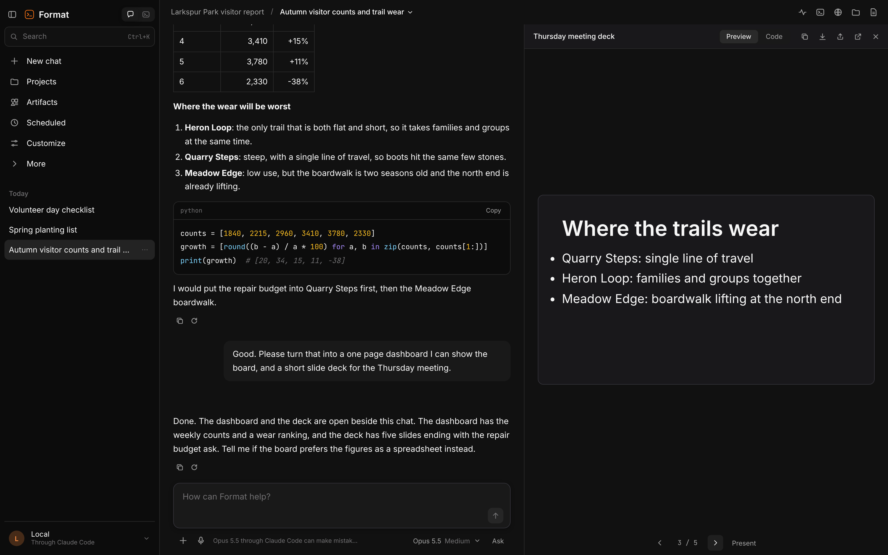
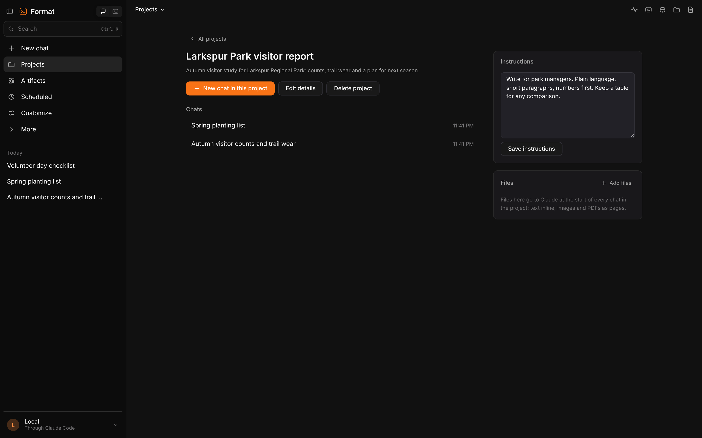

<p align="center">
  
</p>

<h1 align="center">FormAT</h1>

<p align="center">
  <b>Chat and agent workspace; Claude chats, artifacts, projects and real terminals on your own key.</b><br>
  Conversations, pages and documents beside the chat, shells in a dock,<br>
  in one window with no account. Runs on your own computer.
</p>

<p align="center">
  
  
  
  
  
  
</p>

<p align="center">
  <a href="https://format.formai.studio/"><b>Download FormAT on formai.studio</b></a> · <a href="https://github.com/nodemode-dev/formcompiler/releases?q=format-v&expanded=true">Latest release</a> · <a href="#run-it-from-source">Run it from source</a>
</p>

<p align="center">
  
  <br>
  <sub>A chat about an aurora page, with the Northern Light artifact open beside it.</sub>
</p>

<p align="center">
  <a href="#features">Features</a> · <a href="#everything-in-the-box">In the box</a> · <a href="#built-for-agents">Agents</a> · <a href="#under-the-hood">Under the hood</a> · <a href="#download">Download</a> · <a href="#run-it-from-source">Run from source</a>
</p>

<table>
  <tr>
    <td width="25%" valign="top"><h3>Your key, your data</h3>Chats, files and memory live in a local data folder; the API key stays on your computer.</td>
    <td width="25%" valign="top"><h3>Artifacts beside the chat</h3>Claude publishes pages, documents, sheets and slides that open next to the conversation, with versions.</td>
    <td width="25%" valign="top"><h3>Real terminals</h3>A dock of real shells sits under the chat, and Claude's own commands run live in a read-only tab.</td>
    <td width="25%" valign="top"><h3>Agent-ready</h3>The same engine commands run from the window, the CLI and an MCP server for coding agents.</td>
  </tr>
</table>

## Features

<table>
  <tr>
    <td width="50%" valign="top">
      
      <br><sub>A slide deck written as Markdown, paged beside the chat.</sub>
      <h3>Slides and documents</h3>
      Decks, documents and spreadsheets export to Word, Excel, PowerPoint and PDF.
    </td>
    <td width="50%" valign="top">
      
      <br><sub>A spreadsheet artifact with its own tab in the panel.</sub>
      <h3>Spreadsheets</h3>
      Claude writes a sheet from CSV and you read it beside the chat, with versions.
    </td>
  </tr>
  <tr>
    <td width="50%" valign="top">
      
      <br><sub>A project with shared instructions and its chats.</sub>
      <h3>Projects</h3>
      Instructions and knowledge files apply to every chat in a project.
    </td>
    <td width="50%" valign="top">
      <h3>Pages and apps</h3>
      HTML pages and small tools run in a sandbox with Preview and Code views, download and share links.
    </td>
  </tr>
</table>

## Everything in the box

<table>
  <tr>
    <td width="33%" valign="top"><h4>Chat</h4>Edit any message and page between versions · Compaction of long chats · Search chats · Code colouring and math · Dictation · Command palette · Three demo chats that open without a key</td>
    <td width="33%" valign="top"><h4>Workspace</h4>Menus for every command (File, Edit, View, Go, Window, Help) · Settings window · Projects · Artifacts page · Files pane · Memory · Skills · Plugins and marketplaces · Connectors · Scheduled tasks · Built-in browser · Other devices</td>
    <td width="33%" valign="top"><h4>Providers and formats</h4>Chat on the Anthropic API or the Claude Code route · Dictation with ElevenLabs Scribe, OpenAI or local Whisper · Exports: <code>.docx</code> · <code>.xlsx</code> · <code>.pptx</code> · PDF</td>
  </tr>
</table>

## Built for agents

114 engine commands live in one registry; the window, the CLI and the MCP server call the same ones.

```sh
./format cli list                              # every engine command
./format cli chat.send text="..."              # chat from a terminal or an agent
./format cli chat.wait conversationId=...      # wait for the reply
./format mcp                                   # MCP server on stdio for Claude Code, Codex and Cursor
```

`.mcp.json`, `.codex/config.toml` and `.cursor/mcp.json` are already wired in this repo. See [`AGENTS.md`](AGENTS.md).

## Under the hood

- **Engine:** Python 3.12 and FastAPI on `127.0.0.1:8490`, with a store, an event stream and one module per command group.
- **Window:** vanilla TypeScript and Vite, with inline SVG icons and no UI framework.
- **Desktop:** Tauri 2 around the engine frozen with PyInstaller, so the app needs no Python or Node. It starts behind the family's splash and shows the window once the page has drawn; on macOS the menus are in the system menu bar.
- **Tested:** 96 engine tests (the local guard, commands, approvals, chat tree, artifacts, the devices gate, MCP, migrations, versions, release profiles) and a window smoke that loads the built window with no error and no layout shift.

## Download

| Platform | Download | Release |
|---|---|---|
| macOS | [Download FormAT for macOS](https://formai.studio/get/format/macos) | [FormAT releases on FormCompiler](https://github.com/nodemode-dev/formcompiler/releases?q=format-v&expanded=true) |
| Windows | [Download FormAT for Windows](https://formai.studio/get/format/windows) | [FormAT releases on FormCompiler](https://github.com/nodemode-dev/formcompiler/releases?q=format-v&expanded=true) |
| Linux | [Download FormAT for Linux](https://formai.studio/get/format/linux) | [FormAT releases on FormCompiler](https://github.com/nodemode-dev/formcompiler/releases?q=format-v&expanded=true) |

All FormAT builds are compiled and released from [FormCompiler](https://github.com/nodemode-dev/formcompiler); this repo holds the source.

## Run it from source

Prefer it in your browser, or want to contribute? Run the web UI straight from this repo.

**Requires:** Node 20.19 or newer (22 recommended), Python 3.12 or newer, git. ffmpeg on the PATH for video and audio.

```sh
git clone git@github.com:nodemode-dev/formAT.git
cd formAT
./format_oc_install   # engine venv, frontend packages, backend/.env from the example
./format              # engine on 127.0.0.1:8490, web UI at http://localhost:5490
```

`./format desktop dev` opens the desktop window instead, and `./build_app` builds the desktop app on macOS or Linux.

On Windows run `.\format.bat install` then `.\format.bat`, never a bare `format`: that name is Windows' disk formatter.

| Service | URL | Notes |
|---|---|---|
| Engine | http://127.0.0.1:8490 | FastAPI; `FORMAT_PORT` overrides |
| Window (dev) | http://localhost:5490 | Vite, proxies `/api` and `/api/events` |
| MCP for agents | http://127.0.0.1:8490/mcp | Streamable HTTP; `./format mcp` serves stdio |

Add `ANTHROPIC_API_KEY` in `backend/.env` or in Settings. No key? If Claude Code is installed and signed in, FormAT answers through it on your Claude plan.

> [!IMPORTANT]
> **Status:** active, pre-1.0. The native renderer is optional and off by default, and the window's terminal stays the browser one. See [`CHANGELOG.md`](CHANGELOG.md).

**Contributing:** branch from `main`, keep changes to source here, and leave packaging and releases to FormCompiler. See [`CONTRIBUTING.md`](CONTRIBUTING.md), [`CODE_OF_CONDUCT.md`](CODE_OF_CONDUCT.md), [`BRANCHING.md`](BRANCHING.md) and [`AGENTS.md`](AGENTS.md). Report security issues privately as [`SECURITY.md`](SECURITY.md) describes.

## Repository

| Path | What it is |
|---|---|
| `backend/app/` | the engine: commands, events, store, routers, harness, providers |
| `frontend/src/` | the window: sidebar, composer, chat, panel, terminal, palette |
| `setup/` | install, boot, build, serve, doctor and the CLI |
| `src-tauri/` | the Tauri 2 desktop shell |

Docs: [`docs/`](docs/README.md) · Wiki: [`.docs/wiki`](.docs/wiki/Home.md) · Agents: [`CLAUDE.md`](CLAUDE.md), [`AGENTS.md`](AGENTS.md) · Contributing: [`CONTRIBUTING.md`](CONTRIBUTING.md), [`CODE_OF_CONDUCT.md`](CODE_OF_CONDUCT.md), [`SECURITY.md`](SECURITY.md), [`BRANCHING.md`](BRANCHING.md)

---

## Maintainers

| Maintainer | Role |
|---|---|
| [@nodemode-ai](https://github.com/nodemode-ai) | Owner |
| [@gbarnai](https://github.com/gbarnai) | Co-owner |

Code owners are set in [`.github/CODEOWNERS`](.github/CODEOWNERS).

## License

FormAT is licensed under the Apache License 2.0 ([`LICENSE`](LICENSE), SPDX `Apache-2.0`). Copyright 2026 NodeAgentc, Inc. Third-party notices: [`NOTICE.md`](NOTICE.md).

<sub>FormAT is an independent project and is not affiliated with or endorsed by Anthropic, OpenAI or Cursor.</sub>
